# ZAIREN LAB // DOCUMENTACIÓN INTEGRAL DEL PROYECTO
> **Versión del Sistema:** v2.8 Core (Producción)  
> **Fecha de Actualización:** Octubre 2026  
> **Objetivo de este Documento:** Servir como especificación técnica completa y autónoma para que cualquier IA o desarrollador entienda en su totalidad qué hace la web, qué tecnologías utiliza, cómo está estructurada y qué reglas de negocio rigen su funcionamiento, **sin necesidad de inspeccionar el código fuente**.

---

## 1. Visión General del Proyecto

**ZAIREN LAB** es una plataforma de comercio electrónico exclusiva para una marca de ropa de autor (*Streetwear & Aesthetic Studio*). 
* **Estética y Filosofía:** Minimalismo Zen combinado con elementos Cyberpunk / Geométricos oscuros (*Sumi-iro*, *Carmín Zen*, tipografía tipográfica editorial y fondos oscuros con texturas de ruido sutil).
* **Enfoque de Navegación:** El usuario aterriza directamente en el catálogo protagónico (`/`), sin páginas de inicio redundantes ni textos de relleno.
* **Modelo de Conversión:** El catálogo permite explorar prendas por colecciones colapsables, ver disponibilidad real en tiempo real por talla, agregar al carrito y procesar la orden final mediante un **checkout automatizado hacia WhatsApp**, con verificación de bots mediante **Cloudflare Turnstile**.
* **Gestión Interna:** Panel de administración protegido (`/admin`) para gestión de existencias en vivo, creación de prendas con matriz de tallas, mediateca para reusar fotos de Cloudinary y conversión forzosa a formato `.webp` en el cliente.

---

## 2. Stack Tecnológico e Infraestructura

| Capa | Tecnología | Propósito |
| :--- | :--- | :--- |
| **Framework Base** | **Astro 5.x** | Arquitectura orientada a componentes e islas. Generación híbrida: **SSG** (rutas estáticas optimizadas) y **SSR** (rutas dinámicas de producto y panel). |
| **Librería UI Interactiva** | **React 19** | Islas interactivas hidratadas (`client:load`) para el catálogo interactivo, carrito drawer, filtros, modales y panel admin. |
| **Diseño y Estilos** | **Tailwind CSS v3/v4** + CSS Modules | Diseño responsivo móvil-first, sistema de diseño ortogonal (bordes rectos, acentos carmesí `#DC143C`, paletas `#0A0A0A`, `#141416`, `#FAF9F6`). |
| **Gestión de Estado** | **Nanostores** (`@nanostores/react`) | Estado atómico ultraligero y desacoplado para el carrito (`$cart`), visibilidad del drawer (`$isDrawerOpen`) y persistencia en `localStorage`. |
| **Base de Datos & Auth** | **Supabase (PostgreSQL 15)** | Base de datos relacional con Row Level Security (RLS), autenticación de administradores, triggers de auditoría y vistas optimizadas (`vw_catalogo_publico`). |
| **Alojamiento & Edge** | **Cloudflare Pages** | Despliegue en la red Edge mediante `@astrojs/cloudflare` con SSR habilitado. |
| **Seguridad Anti-Bot** | **Cloudflare Turnstile** | Verificación criptográfica no invasiva en el checkout de WhatsApp y en el login administrativo. |
| **CDN de Imágenes** | **Cloudinary** | Servidor de medios con transformaciones automáticas. Todas las fotos subidas se convierten estrictamente a `.webp` en el navegador antes del envío. |
| **Tipografías** | Google Fonts | `Cormorant Garamond` (editorial zen), `JetBrains Mono` / `Space Mono` (técnico core), `Inter` (cuerpo de lectura). |
| **Notificaciones** | **Sonner** | Toasts accesibles y minimalistas para confirmaciones de carrito y acciones de inventario. |

---

## 3. Identidad de Marca y Restricciones Operativas (Brand Rules)

1. **Restricción de Origen y Jerga:** Queda estrictamente prohibido mencionar términos asociados a talleres artesanales, manufactura tradicional o referencias geográficas locales. La marca se comunica como un estudio independiente de diseño contemporáneo (*Zairen Lab // Aesthetic Studio*).
2. **Geometría y Estilo:** Bordes rectos ortogonales (`rounded-none`), micro-líneas de acento degradadas en carmesí Zen (`#DC143C`), sombras volumétricas controladas y tipografías monoespaciadas para SKUs y códigos técnicos.
3. **Persistencia de Tema:** Soporte completo de modo Claro / Oscuro sincronizado en `localStorage` (`zairen_theme`) y blindado ante el retroceso de historial del navegador (*bfcache*) mediante escuchadores `pageshow`.
4. **Acceso Administrativo Discreto:** El enlace al login administrativo en el pie de página está mimetizado como un microtexto técnico (`sys.v2`), sin apariencia de botón. Si el usuario ya cuenta con sesión abierta en Supabase, el sistema lo redirige de inmediato a `/admin` sin solicitar credenciales nuevamente.

---

## 4. Arquitectura de Datos y Base de Datos (Supabase)

### 4.1. Tablas Principales
* `public.producto`: Identificador (UUID), nombre, slug, precio de venta, precio de costo, stock mínimo, estado comercial (`nuevo`, `disponible`, `preventa`, `oferta`, `agotado`), visibilidad (`publicado`, `activo`).
* `public.coleccion`: Agrupador de prendas (ej: *Anime Mecha // Drop 01*, *Cyberpunk Tokyo*, *Essentials*). Posee slug, orden y estado activo.
* `public.inventario`: Control de stock físico consolidado por producto y ubicación (`CENTRAL`).
* `public.atributo_producto`: Desglose clave-valor.
  * Tallas registradas: `clave = 'talla'`, `valor = 'M'`.
  * Stock específico por variante: `clave = 'stock_M'`, `valor = '1'`.
* `public.imagen`: URLs de Cloudinary asociadas al producto, con flags para imagen de portada (`es_portada = true`), dorsal o galería secundaria.
* `public.pedido` / `public.detalle_pedido`: Registro de órdenes recibidas con datos del cliente y estado (`PENDIENTE`, `EN_PROCESO`, `COMPLETADO`).
* `public.configuracion`: Registro singleton con datos de la marca, número de WhatsApp, políticas de envío y visibilidad de redes sociales.

### 4.2. Vista Consolidada: `vw_catalogo_publico`
La web pública no realiza consultas múltiples; consume esta vista SQL optimizada que entrega en un único JSON:
* Datos de la prenda, slug y colección activa.
* URLs directas de imagen de portada y dorsal.
* Suma de existencias disponibles (`stock_disponible`).
* Objeto JSON agrupado `atributos` con las claves exactas `stock_S`, `stock_M`, `stock_L`, `stock_XL`.

---

## 5. Módulos del Sistema y Flujos de Usuario

```mermaid
flowchart TD
    subgraph Cliente["Experiencia del Cliente (Tienda Pública)"]
        A["Acceso a /"] --> B["Catálogo Unificado (CatalogoGrid)"]
        B -->|Filtro / Búsqueda| C["Filtrado por Colección o Estado"]
        B -->|Click en Tarjeta| D["Vista Detalle /producto/[id]"]
        B -->|Añadir Rápido| E["Validación Stock x Talla"]
        D -->|Seleccionar Talla con Stock| E
        E --> F["Nanostores (cartStore)"]
        F --> G["Drawer Carrito de Compras"]
        G -->|Desafío Turnstile| H["Generación Enlace WhatsApp"]
        H --> I["Redirección WhatsApp con Pedido Formateado"]
    end

    subgraph Admin["Panel Administrativo (/admin)"]
        J["Acceso sys.v2 en Footer"] --> K["Auto-login si hay sesión / Formulario"]
        K --> L["Dashboard & KPI Cards"]
        L --> M["InventarioManager (Control en Vivo)"]
        M --> N["ProductoEditor Modal"]
        N -->|Subir Foto| O["Conversor Canvas a WebP en Cliente"]
        O --> P["Cloudinary CDN (Solo .webp)"]
        N -->|Reutilizar| Q["Mediateca Cloudinary"]
        N --> R["Guardado en Supabase (producto, atributos, inventario)"]
    end
```



### 5.1. Catálogo Público (`src/pages/index.astro` + `CatalogoGrid.tsx`)
* Carga SSR/SSG inicial desde `vw_catalogo_publico`.
* Extrae el diccionario reactivo `stockPorTalla` (`{ M: 1, S: 0, ... }`).
* **Filtros Dinámicos:**
  * Selector de Colecciones: Muestra únicamente colecciones que tengan al menos 1 prenda activa; oculta categorías vacías o predeterminadas no creadas por el usuario.
  * Selector de Estados: *Todos*, *Pre-Order ⚡*, *Nuevo Drop 🔥*, *Promoción 🏷️*, *Oferta 💥*.
  * Checkbox *Solo en stock*.
  * Botón interactivo global `[ Contraer Todo / Expandir Todo ]` para alternar todas las secciones simultáneamente.
* **Tarjeta de Prenda (`TarjetaPolera.tsx`):**
  * Fondo `#141416` con acento carmesí expansivo en hover.
  * Selector de tallas: **Las tallas con 0 existencias aparecen tachadas (`line-through`), con opacidad reducida (`opacity-30`) y deshabilitadas para click**.
  * Preselecciona automáticamente la primera talla con stock disponible.
  * Botón de compra rápido con morphing icon (cambia a check verde al agregar).

### 5.2. Vista Individual de Producto (`src/pages/producto/[id].astro` + `DetalleProducto.tsx`)
* Configurada con SSR (`export const prerender = false;`) para responder instantáneamente tanto a UUIDs como a Slugs amigables.
* **Layout Bento Grid Zen:**
  * **Caja Fotográfica:** Proporción adaptable que muestra la **prenda completa sin recortes** (`object-contain`) sobre fondo `#0E0F11`.
  * **Galería Interactiva:** Transición cross-fade suave al alternar entre fotos principales o miniaturas, flechas ortogonales de navegación e icono flotante para pantalla completa.
  * **Bloque de Tallas:** Desglose interactivo donde las tallas agotadas no se pueden pulsar. Si todas las tallas están en 0, el producto se marca como `AGOTADO` y bloquea las acciones de compra.
  * **Botones de Conversión:** Botón de consulta directa por WhatsApp y botón para añadir a la bolsa.

### 5.3. Carrito y Checkout (`cartStore.ts` + `CarritoDrawer.tsx`)
* **Límite Estricto de Unidades:** El contador de cada prenda está limitado por su `stockDisponible`. No permite aumentar unidades por encima del inventario real ni agregar productos con stock 0.
* **Cloudflare Turnstile:** Widget ultra-compacto (<45px de alto) integrado al pie del carrito. Valida criptográficamente al usuario sin bloquear ni congelar el botón de WhatsApp.
* **Checkout Automatizado:** Al hacer click en *Completar Pedido por WhatsApp*, compila un mensaje codificado con:
  1. Lista detallada de prendas, códigos SKU y tallas elegidas.
  2. Subtotal, cálculo de envío (gratis si supera el umbral configurado) y total en Bolivianos (Bs).
  3. Enlace directo al chat oficial de la tienda (`https://wa.me/...`).

### 5.4. Panel de Control Administrativo (`/admin` + `InventarioManager.tsx`)
* **Diseño 100% Responsivo Móvil:** Toda la interfaz cuenta con contención de desbordamiento (`overflow-x-hidden w-full max-w-full`), eliminando cualquier scroll horizontal accidental en pantallas de 360px a 390px.
* **Micro-Cards KPI:** Muestra en tiempo real total de prendas, SKUs activos y variantes con bajo stock en un grid adaptable.
* **Filtros Horizontales Contenidos:** Chips de colecciones y estados envueltos en contenedores de scroll suave.
* **Editor de Prendas (`ProductoEditor.tsx`):**
  * Configuración de nombre, slug, precio de venta, costo, categoría y colección.
  * **Matriz de Stock por Talla:** Asignación numérica individual para S, M, L y XL.
  * **Mediateca Cloudinary:** Botón que despliega una cuadrícula modal con todas las fotos ya registradas en la base de datos, permitiendo reusar cualquier imagen previa con 1 solo click sin tener que subirla de nuevo ni copiar URLs.
* **Conversión Obligatoria a WebP (`imageUploader.ts`):**
  * Antes de enviar cualquier imagen (JPG, PNG, HEIC, etc.) hacia Cloudinary, el navegador la procesa en un `<canvas>` HTML5 invisible.
  * La imagen se redimensiona proporcionalmente (máx 1600px) y se codifica como `Blob` de tipo estricto `image/webp` con calidad `0.85` (reducción de hasta un 85% de peso).
  * La función de subida verifica el MIME type `image/webp`. **Cloudinary solo recibe y almacena archivos `.webp`**.

---

## 6. Estructura de Directorios Clave

```
Zairen-web/
├── docs/                        # Planes y documentación de despliegue
├── public/                      # Assets estáticos (favicon, robots.txt)
├── src/
│   ├── components/
│   │   ├── admin/               # Panel Core
│   │   │   ├── dashboard/       # Métricas, pedidos pendientes, alertas
│   │   │   ├── inventario/      # InventarioManager, ProductoEditor, MatrizStock
│   │   │   └── layout/          # AdminSidebar colapsable, drawer móvil
│   │   ├── catalogo/            # Catálogo Público
│   │   │   ├── CatalogoGrid.tsx # Filtros, secciones colapsables y cuadrícula
│   │   │   ├── TarjetaPolera.tsx# Tarjeta interactiva con stock por talla
│   │   │   ├── DetalleProducto.tsx # Bento grid, galería y compra
│   │   │   └── CarritoDrawer.tsx   # Drawer lateral de bolsa y checkout
│   │   ├── common/              # Navbar, Footer, TurnstileWidget, SplashLoader
│   │   └── ui/                  # Componentes base (MorphIcon, Toaster)
│   ├── config/
│   │   └── site.ts              # Configuración central de marca, WhatsApp y SEO
│   ├── layouts/
│   │   ├── Layout.astro         # Layout base de la tienda pública con tema bfcache
│   │   └── AdminLayout.astro    # Layout responsive del panel de administración
│   ├── lib/
│   │   ├── cloudinary.ts        # Inyección de transformaciones CDN
│   │   ├── imageUploader.ts     # Conversor Canvas a WebP y uploader unsigned
│   │   └── supabase.ts          # Cliente Supabase tipado
│   ├── pages/
│   │   ├── index.astro          # Home de la web (Catálogo Oficial directo)
│   │   ├── producto/[id].astro  # Vista SSR de prenda individual
│   │   ├── login.astro          # Acceso administrativo con Turnstile y auto-login
│   │   └── admin/               # Rutas administrativas (inventario, pedidos, etc.)
│   └── stores/
│       └── cartStore.ts         # Nanostores para items, cantidades y límites de stock
├── supabase/                    # Migraciones SQL, esquemas, triggers y vistas
├── package.json                 # Dependencias y scripts
└── astro.config.mjs             # Configuración de Astro con adapter Cloudflare
```

---

## 7. Instrucciones para la IA Receptora (Prompt de Entrada)

Si deseas entregar este documento a otra IA para solicitarle análisis, mejoras de código o propuestas de diseño, utiliza el siguiente encabezado junto con este archivo:

```text
Actúa como un Diseñador y Desarrollador Web Senior especialista en Astro 5, React 19, Tailwind CSS, PostgreSQL y eCommerce de alta gama.

Te adjunto el documento "DOCUMENTACION_PROYECTO_ZAIREN_LAB.md" que describe al 100% la arquitectura, diseño, lógica de negocio, modelo de datos y estado actual de mi proyecto web ("Zairen Lab").

REQUERIMIENTO:
Lee la documentación detenidamente y propónme un plan estratégico de mejoras enfocado en:
1. Micro-interacciones y UX/UI: ¿Qué detalles de diseño Zen/Streetwear pueden elevar la percepción de marca y la tasa de conversión?
2. Rendimiento y Core Web Vitals: Sugerencias de optimización adicionales para navegación móvil y tiempos de renderizado.
3. Nuevas funcionalidades de valor: Ideas de características útiles para la tienda o el panel de control que se integren de forma natural con el stack actual (Astro + Supabase + Cloudflare).
```


---

## 8. Registro de Actualizaciones (Changelog Técnico v3)

### Fase 1: Resiliencia de Ficha de Producto y Manejo de Errores
- **Gestión de 404 en SSR (`/producto/[id]`):** Si el producto no existe o está inactivo (`activo = false` o `publicado = false`), el servidor responde con código de estado HTTP 404 y renderiza una vista dedicada *"Este producto ya no está disponible"* con botón hacia el catálogo público (`/`), evitando redirecciones silenciosas (302) que desconectaban extensiones del navegador.
- **Blindaje ante datos nulos en `DetalleProducto.tsx`:** Normalización defensiva de imágenes (placeholder oficial de Zairen Lab si el arreglo está vacío o no contiene strings válidos), tallas (`['S', 'M', 'L', 'XL']` por defecto), precios seguros sin `NaN`, y SKUs formateados sin dependencias de valores nulos.
- **Saneamiento reactivo de carrito persistido:** Implementación de `validarYLimpiarCarrito()` en `cartStore.ts`. Verifica la existencia y estado activo de las prendas almacenadas en `localStorage` (`zairen_cart_v2`) al iniciar o abrir el `CarritoDrawer`, retirando automáticamente cualquier prenda eliminada con una notificación discreta (`toast.info`).
- **Validación robusta en checkout:** `/api/checkout-validate` valida existencia y estado activo de cada producto antes de calcular inventarios, resolviendo identificadores UUID y slugs.

### Fase 2: Colecciones Dinámicas y Eliminación Segura
- **Funciones RPC PostgreSQL:** `eliminar_coleccion_segura(p_coleccion_id)` y `eliminar_o_archivar_producto_seguro(p_producto_id)` ejecutadas con permisos de seguridad definer.
- **Regla de negocio de colecciones:** Bloqueo automático si existen productos con stock disponible ($>0$ unidades); desacoplamiento a `coleccion_id = NULL` ("Sin colección") si todos sus productos están agotados, ocultándolos automáticamente del catálogo público pero manteniéndolos visibles en el panel administrativo con insignia ámbar.
- **Regla de negocio de productos:** Si el producto cuenta con pedidos en `detalle_pedido`, se archiva (`activo = false, publicado = false`) preservando el historial contable; si no tiene pedidos, se eliminan registros dependientes (`inventario`, `atributo_producto`, `imagen`) protegiendo los activos multimedia de Cloudinary.

### Fase 3: Revalidación Casi Instantánea del Catálogo (Edge Cache)
- **SSR con cabeceras de caché Edge:** `src/pages/index.astro` configurado con `Cache-Control: public, max-age=0, s-maxage=3, stale-while-revalidate=5` para propagación en $\le 3$ segundos en Cloudflare Pages sin requerir purgas de zona no disponibles en `*.pages.dev`.
- **Control de versiones del catálogo:** Tabla `configuracion` almacena `catalogo_version` incrementado mediante trigger (`trg_incrementar_version_catalogo`) y mediante endpoint seguro `/api/admin/revalidar-catalogo`.

### Fase 4: Títulos de Página y Consistencia de Marca
- **Eliminación sistemática de sufijos redundantes:** Retirado todo sufijo `// ZAIRENLAB` en pestañas y metadatos (`<title>`, `og:title`, `twitter:title`).
- **Nombres directos por sección:** Páginas del panel muestran exclusivamente su área ("Inventario", "Pedidos", "Ventas", "Usuarios", "Clientes", "Interfaz web", "Ingresar"). Ficha de producto muestra exclusivamente el nombre de la prenda. Catálogo público muestra "Zairen".
- **Sincronización dinámica de título en modal:** Al abrir el detalle de una prenda, el título del documento se sincroniza en vivo con el nombre del producto y se restaura al cerrar.

### Fase 5: Canales de Contacto Oficiales y Prioridades
- **Arquitectura de Canales Dinámicos (`src/lib/contactChannels.ts`):** Soporte unificado para WhatsApp, Instagram, TikTok, Facebook y canales web personalizados, con reordenamiento interactivo (prioridad por orden ascendente) y validación de formatos telefónicos y handles.
- **Política de visibilidad en el catálogo:**
  - En la tarjeta del catálogo (`TarjetaPolera`): se muestra exclusivamente el **primer canal activo** según el orden de prioridad, manteniendo una interfaz minimalista y libre de saturación de iconos.
  - En la vista/modal de detalle (`DetalleProducto`): se renderiza la grilla completa con **todos los canales activos** con mensajes personalizados preformateados.
  - Si no existen canales activos, el bloque se oculta completamente sin dejar espacios vacíos.
- **Barra flotante inferior de guardado:** Detección de estado modificado (`isDirty`), botones *"Descartar"* y *"Guardar y Publicar"*, protección con `beforeunload` y sincronización inmediata con revalidación Edge.

### Fase 6: Selector de Colecciones Dinámico Accesible (Combobox)
- **Componente `ColeccionCombobox.tsx`:** Reemplazo de chips planos horizontales por un control Combobox accesible (`role="combobox"`, `aria-expanded`, `aria-haspopup="listbox"`, `aria-activedescendant`) con navegación completa por teclado (Flechas Arriba/Abajo, Enter, Escape).
- **Filtrado dinámico con conteo real de prendas:** Calcula en tiempo real las prendas activas por colección, filtrando colecciones vacías o "Sin colección", y presentando opción destacada *"Todas las colecciones"* con el total de inventario disponible.
- **Buscador interactivo integrado:** Campo de búsqueda interno que filtra colecciones al vuelo mientras se escribe.
- **Sincronización bidireccional con URL (`?coleccion=<slug>`):** Inicializa la vista desde el parámetro de consulta en la URL, actualiza la URL mediante `history.pushState` sin recargar la página, y soporta navegación nativa con el botón Atrás/Adelante (`popstate`).
- **Compatibilidad móvil extrema (360px–390px):** Diseñado con altura mínima táctil de 44px (WCAG 2.2 AA) y ancho 100% responsivo sin generar desbordamiento horizontal (`overflow-x`).

### Fase 7: Modal Grande / Ficha de Producto Deslizable en Catálogo
- **Componente `ModalDetalleProducto.tsx`:** Ficha de producto integrada en modal deslizable sobre el catálogo público con diseño responsive adaptativo: bottom-sheet a pantalla completa con tirador táctil y gesto hacia abajo en móvil ($le 768\text{px}$), y ventana bento centrada en escritorio.
- **Transición suave y acelerada por hardware:** Desplazamiento vertical fluido utilizando exclusivamente propiedades `transform: translateY` y `opacity` para garantizar 60 FPS sin provocar repintados de página (*layout shifts*, CLS = 0).
- **Control de accesibilidad y foco (WCAG):** Atrapa el foco dentro del modal (`role="dialog"`, `aria-modal="true"`), bloquea el desplazamiento del fondo (`document.body.style.overflow = 'hidden'`) y restaura el foco a la tarjeta de origen al cerrarse.
- **Sincronización de historial con `pushState` y `popstate`:** Al abrir una prenda, la URL cambia a `/producto/[slug]` permitiendo compartir el enlace directamente; al pulsar el botón Atrás del navegador, el modal se cierra suavemente preservando la posición de lectura del catálogo.
- **Persistencia de ruta SSR de contingencia:** La ruta servida por el servidor `/producto/[id].astro` se mantiene operativa para accesos directos, rastreadores SEO y navegación sin JavaScript.

### Fase 8: Micro-interacciones Zen y Optimización de Fluidez (60 FPS & CLS = 0)
- **Aceleración por GPU estricta:** Todas las micro-interacciones interactivas se ejecutan exclusivamente sobre propiedades compuestas por GPU (`transform` y `opacity`), erradicando bloqueos del hilo principal del navegador (`INP < 100ms`).
- **Elevación y feedback táctil en tarjetas:** Las tarjetas de producto implementan una elevación sutil (`hover:-translate-y-1.5`), una micro-línea Zen de acento degradado carmesí (`#DC143C`) que se expande orgánicamente en la base, y compresión al pulsar (`active:scale-[0.98]`).
- **Feedback háptico visual en `CartBadge`:** Animación de rebote (`@keyframes cartBump`) que se dispara de forma aislada y reactiva únicamente cuando el usuario añade una prenda nueva a la bolsa.
- **Transición suave en `CarritoDrawer`:** Despliegue lateral con aceleración de hardware (`slide-in-from-right`), desvanecimiento de fondo oscurecido y micro-interacción de pulsación elástica en los botones de incremento y decremento de unidades.
- **Respeto absoluto de `prefers-reduced-motion`:** Soporte de accesibilidad para visitantes con sensibilidad al movimiento mediante supresión automática de animaciones en media queries (`animation-duration: 0.01ms`, `transition-duration: 0.01ms`).
- **Garantía de Cumulative Layout Shift (CLS = 0):** Los contenedores y la cuadrícula de catálogo mantienen alturas mínimas estables evitando saltos de maquetación durante el filtrado y la navegación reactiva.
