# Plan: Zairen Lab → Producción Real

## Objetivo

Llevar Zairen Lab de un prototipo con datos mock y verificaciones falsas a una **tienda online real y funcional** en `zairenlab.pages.dev`. Esto incluye verificación Cloudflare Turnstile real, logos vía Cloudinary, catálogo alimentado desde Supabase, configuraciones admin persistentes, y correcciones visuales.

## User Review Required

> [!IMPORTANT]
> **Cambio de output mode en Astro**: Actualmente el proyecto usa `output: 'static'` con el adaptador de Cloudflare. Para tener un endpoint API que valide Turnstile del lado del servidor (`/api/verify-turnstile`), necesitamos cambiar a `output: 'hybrid'` (o `'server'`). Con `hybrid`, las páginas siguen siendo estáticas por defecto, y solo los endpoints que necesiten SSR (como la API de verificación y la página de admin) usan el servidor. **Este cambio no rompe el catálogo público ni las páginas estáticas.**

> [!WARNING]
> **Eliminación del login demo hardcodeado**: Se eliminó el bypass con credenciales `admin@zairenlab.com / admin123` por seguridad. Solo funcionará el login real de Supabase Auth. Asegúrate de tener tu usuario creado en Supabase Auth antes de desplegar.

> [!CAUTION]
> **Eliminación de imágenes locales**: Se eliminaron todos los archivos de `public/brand/` y `public/editorial/` excepto `favicon.ico`. Los logos pasan a Cloudinary URLs. Las imágenes de productos vienen de Supabase/Cloudinary.

---

## Estrategia de Branches y PR

Se trabaja en la rama de desarrollo `feature/produccion-real-v1` creada desde `main`. Cada fase se implementa con commits atómicos dentro de esa rama. Al finalizar todo, se crea un único PR hacia `main`.

```mermaid
flowchart LR
    A["main (producción)"] --> B["feature/produccion-real-v1"]
    B --> C["Fase 1: Turnstile Real"]
    C --> D["Fase 2: Logos Cloudinary"]
    D --> E["Fase 3: Carrito UX"]
    E --> F["Fase 4: Splash Loader"]
    F --> G["Fase 5: Settings DB"]
    G --> H["Fase 6: Productos Supabase"]
    H --> I["Fase 7: Admin Light Mode"]
    I --> J["Fase 8: Cleanup"]
    J --> K["PR → main"]
```

---

## Fases del Plan

---

### Fase 1: Cloudflare Turnstile Real (Carrito + Login Admin)
- Endpoint SSR `/api/verify-turnstile.ts` que valida criptográficamente tokens contra Cloudflare.
- Componente `TurnstileWidget.tsx` con soporte para validación cliente-servidor real.
- Integrado en `CarritoDrawer.tsx` y `login.astro`.
- Eliminado cualquier bypass simulado o slider falso.

### Fase 2: Logos Cloudinary (Reemplazar recursos locales)
- Logo oficial `.webp`: `https://res.cloudinary.com/ds4qnoypm/image/upload/v1791690155/zairen_logo_oficial_nehjev.webp`
- Logotipo horizontal `.svg`: `https://res.cloudinary.com/ds4qnoypm/image/upload/v1791689848/zairen_logotipo_horizontal_nrfkp8.svg`
- Actualizado en `Navbar.astro`, `Footer.astro`, `SplashLoader.astro`, `AdminSidebar.tsx`, `CatalogoGrid.tsx`, `HeroPortada.astro`, `Layout.astro`.

### Fase 3: Carrito — No abrir automáticamente al agregar
- Modificado `cartStore.ts` para no invocar `$isDrawerOpen.set(true)` en `addItem()`. El cliente abre el carrito cuando lo desee.

### Fase 4: Splash Loader — Quitar texto, solo imagen
- Simplificado `SplashLoader.astro` mostrando únicamente el isotipo animado en Cloudinary.

### Fase 5: Configuraciones Admin persistentes en Supabase
- Conexión de `ConfiguracionWeb.tsx` con la tabla `public.configuracion` en Supabase.
- Sincronización en vivo de redes sociales en el `Footer.astro`.
- Eliminación del botón duplicado en el panel de ajustes.

### Fase 6: Productos desde Supabase (eliminar mocks)
- Eliminado `src/data/mockProducts.ts`.
- `src/pages/index.astro` y `src/pages/producto/[id].astro` cargan desde `vw_catalogo_publico`.
- `InventarioManager.tsx` y `ProductoEditor.tsx` leen y guardan directamente en las tablas `producto`, `coleccion`, `imagen`, `atributo_producto`, `inventario`.

### Fase 7: Admin Light Mode — Corrección visual
- Aplicados principios de la skill **impeccable**.
- Corrección de alternancia de iconos claro/oscuro (resuelto el problema de que aparecían ambos a plena vista).
- Alto contraste en modo claro: fondos off-white/washi, textos charcoal, preservación estricta de texto blanco en botones carmesí y badges.

### Fase 8: Cleanup final y Variables de entorno
- Eliminadas carpetas `public/brand/` y `public/editorial/`.
- El único archivo en `public/` es `favicon.ico`.
- Documentación de variables requeridas para Cloudflare Pages.
